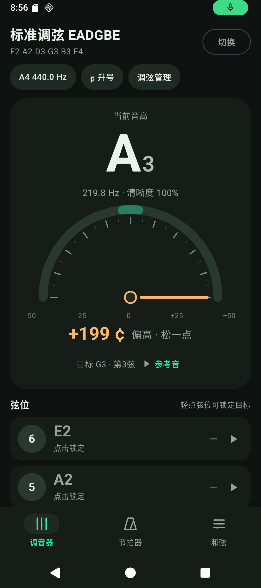
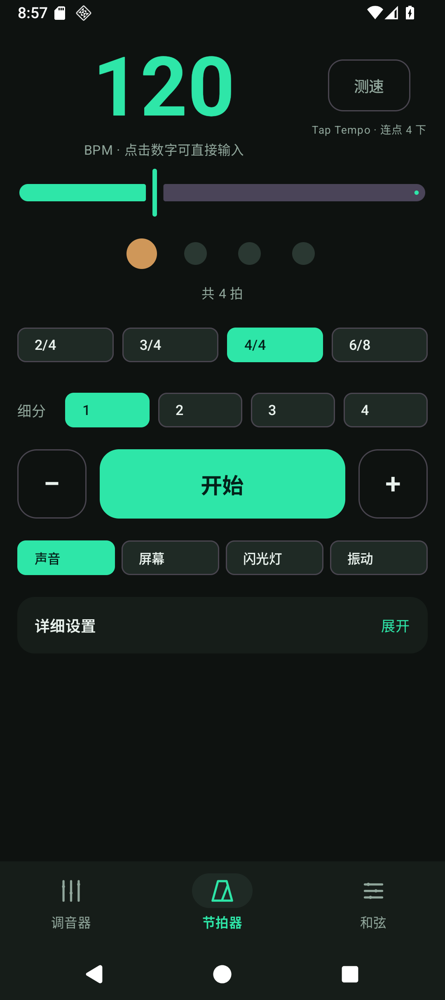
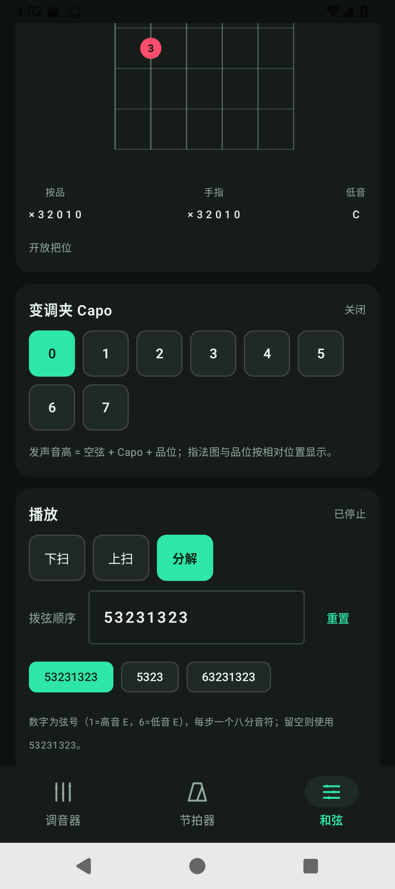

<div align="center">

# TickTuner · 吉他工具箱

**调音器 · 节拍器 · 和弦查找 · 声学分析**

一个完全离线的 Android 吉他工具，适配直板机、横屏演奏与折叠屏多形态，侧载 APK 使用。

[下载 APK](https://github.com/lj5409/TickTuner/releases/latest) · [工程说明](docs/工程说明.md) · [开发计划](docs/开发计划.md) · [测试清单](docs/测试清单.md) · [进度台账](docs/进度.md)

</div>

---

## 界面预览

| 调音器 | 节拍器 | 和弦 |
|---|---|---|
|  |  |  |
## 功能

### 调音器

- 麦克风实时拾音，YIN 音高检测，2048/4096 点自适应窗口，低音 E2（82 Hz）也能稳定识别
- 大号音名 + 频率 + 音分表盘，±3 音分内变绿提示“准”
- 自动匹配当前弦，也可手动锁定某根弦
- 9 套内置调弦：标准、Drop D、降半音、降全音、Open G、Open D、Open Dm、DADGAD、Open C
- **自定义调弦与拖动排序**：命名、逐弦改音、保存、切换；在「调弦管理」中可按住左侧手柄自由拖动排序（内置与自定义统一排序），全局同步至调音器与和弦页，重启不丢
- **循环参考音播放**：点弦号或播放键持续循环播放标准音并显示「■ 停止」按钮，波形带 2/3 次谐波，手机扬声器也能听清低音弦
- **多形态自适应**：横屏/帐篷专注调音（隐藏导航与设置，左满屏调音表 + 右两列满屏弦位不滚动）、折叠屏半折叠悬停模式（上大表盘 + 下双栏弦位与设置）、折叠屏全展开双栏（左侧 NavigationRail + 避让竖向折痕）
- A4 基准 430–450 Hz 可调，♯/♭ 显示切换；弦位保留最后一次识别音分差值

### 节拍器

- 30–300 BPM、2/4 · 3/4 · 4/4 · 6/8、细分 1–4、每拍重音等级
- Tap Tempo、按拍点时间戳驱动的音画同步、±100 ms 校准
- **静音模式**（四种提示可任意组合）：
  - 屏幕：全屏色块/脉冲，颜色与亮度可调
  - 闪光灯：每拍脉冲，强度可调（不支持时自动降级为开/关）
  - 振动：重音/弱拍不同强度
  - 声音可单独关闭
- 闪烁频率 >3 Hz 自动降级为柔和脉冲并提示（光敏安全）

### 和弦查找

- 12 根音 × 18 种和弦类型（maj / min / 7 / maj7 / m7 / m7♭5 / dim / dim7 / aug / sus2 / sus4 / 6 / m6 / add9 / 9 / maj9 / m9 / 5）
- 显示组成音、音级、频率
- 6 弦 15 品指板图：**根音红色高亮**、和弦音蓝色、非和弦音淡灰
- 自动生成 5 个可弹指法，含手指编号与横按，按可演奏性打分排序
- **支持任意调弦**：9 套内置 + 自定义调弦，切换后指板音位、组成音位置与推荐指法全部按新调弦重算
- **Capo 0–7 品**，指法按实际发声音高重新求解
- **扫弦 / 分解播放**：下扫、上扫；分解顺序可自定义（默认 53231323，用 1–6 弦号书写，可保存），指板逐弦拨动动画与音频同步

### 吉他声学分析（FFT 敲击体检）

- **标准 5 点图示引导**：准备说明清单 + 正/背板（含封音孔）脉冲靶心图示，顺序采集「琴码中心 / 琴码侧翼 / 下腹中线 / 背板中心 / 封音孔解耦（可选）」，支持选择手机内置麦或外接 USB/有线指向麦克风
- **严格脉冲质检与高精度 FFT**：敲前 1 秒底噪校准、48 kHz `UNPROCESSED` 采集、冲击测试非对称 Tukey 窗 + 65536 点 FFT + 三点对数抛物线插值（0.1 Hz 精度），自动拦截削波、二次连击、低 SNR、裸弦未消音与离群误敲，5 次功率谱平均与多击一致性 $\gamma^2 \ge 0.90$ 达标后推进（嘈杂环境提供人工确认兜底）
- **声学报告与离线导出**：自动解耦 $A_0 / T_1 / B_1 / T_{2,1} / T_{1,2}$ 模态，排查狼音（精准到具体弦号与品位）、面背板反相相消与琴颈死点，给出五维客观评分、四大曲风（指弹/扫弦/爵士/打击乐）适配度与琴弦/微调建议；支持离线导出标准化 **Markdown** 与**内嵌高清频谱图的 A4 PDF 报告**
- **历史归类、共振峰微调与原始数据**：按吉他名称分组存储（同琴可多次检测），FFT 频谱页注明敲击部位与共振峰代号/频率、支持手动微调峰值自动重算报告并一键保存高清 PNG 至系统相册；提供 30–6000 Hz 完整离散 FFT 原始数据查表与 CSV/JSON 导出
- **双记录横屏叠图对比**：支持同琴或跨琴任意选 2 条记录叠加对比同部位 FFT 频谱，支持一键横屏全屏对比（兼容折叠屏宽屏）、切换 A/B 叠放顺序、8 色高对比曲线自选、0 dB 对齐 / 原始 dBFS 切换、共振峰差值对照表及对比叠图 PNG 下载

---

## 技术栈

| 项目 | 选择 |
|---|---|
| 语言 | Kotlin 2.2.21 |
| UI | Jetpack Compose + Material 3 |
| 架构 | 单 Activity + Navigation Compose + ViewModel/StateFlow |
| 存储 | DataStore Preferences + 本地 JSON 声学档案（`kotlinx.serialization`） |
| 音频 | AudioTrack / AudioRecord / AudioManager（48 kHz、外接麦路由）+ 自研 DSP |
| 音高与声学 | YIN 音高检测；65536 点 Radix-2 FFT + 对数抛物线插值 + 模态解耦与评分引擎 |
| 离线导出 | 原生 `PdfDocument`（带图 A4 PDF）、`Bitmap` PNG 相册导出、SAF + `FileProvider` |
| 吉他音色 | Karplus-Strong 物理建模合成，无需采样素材 |
| 构建 | AGP 8.13.2 / Gradle 8.14.3 / JDK 21 |
| 兼容 | minSdk 26（Android 8.0），targetSdk 36（Android 16） |

## 架构

```
app/src/main/java/com/gtool/
├── core/
│   ├── music/     # 音高、调弦、和弦、指法生成（纯 Kotlin，可单测）
│   ├── acoustic/  # 65536 点 FFT、脉冲质检、5 点模态解耦/评分、MD/PDF/PNG/CSV 导出
│   ├── audio/     # 音高检测、麦克风与外接麦采集、参考音、节拍器、吉他合成、播放器
│   ├── device/    # 闪光灯、振动
│   └── data/      # 设置与自定义调弦（DataStore）+ 声学档案（本地 JSON）
├── feature/
│   ├── tuner/     # 调音器 UI + ViewModel
│   ├── metronome/ # 节拍器 UI + ViewModel + 屏幕闪烁
│   ├── chords/    # 和弦 UI + ViewModel + 指板/和弦图绘制
│   └── acoustic/  # 声学分析主页、建档准备、5 点图示采集、报告/频谱/原始数据、横屏对比
└── ui/            # 主题、四态姿态与 4 Tab 导航壳
```

- `core/music`、`core/acoustic`、`core/audio` 与姿态逻辑不依赖真机，71 项 JVM 单元测试覆盖 FFT 精度/Q 值、脉冲触发与质检、五点模态解耦与缺陷/曲风分析、报告格式化、音高检测、指法生成、分解拨弦顺序、调弦排序、节拍脉冲与折叠屏姿态分类。
- 三个功能各自持有播放器，互不抢占资源；音频事件按采样点调度，UI 通过时间戳对齐。

## 构建

需要 Windows + PowerShell 7（`pwsh`）。首次构建会自动下载 JDK 21、Android SDK 36、Gradle：

```powershell
# 1. 安装便携工具链（约 460 MB，装到 %USERPROFILE%\.android-dev）
& ".\scripts\setup-toolchain.ps1"

# 2. 构建 debug APK
& ".\scripts\build.ps1"

# 3. 构建签名 release APK（需要根目录 keystore.properties）
& ".\scripts\build.ps1" -Variant release

# 单元测试
& ".\scripts\build.ps1" -Tasks "testDebugUnitTest"
```

产物：

- `app/build/outputs/apk/debug/app-debug.apk`
- `app/build/outputs/apk/release/app-release.apk`

> 说明：release 关闭了 R8/资源压缩（开启时资源表异常，APK 只剩 1.7 MB），优先保证运行稳定。

## 安装

1. 从 [Releases](https://github.com/lj5409/TickTuner/releases) 下载最新 `TickTuner-*.apk`；
2. 传到手机后点击安装，按系统提示允许“安装未知应用”；
3. 覆盖安装会保留自定义调弦与设置。

首次进入调音器会申请麦克风权限；闪光灯模式可能申请相机权限。应用不申请网络权限，完全离线。

## 版本

### v0.6.0（2026-11-22）

- **新增「声学」第 4 模块（木吉他敲击 FFT 声学分析）**：
  - 准备说明与建档：支持按吉他名称归类（快速复用已有吉他）、选填箱体形制与备注，支持选择手机内置麦或外接 USB/有线指向麦克风，附 4 项物理准备自检清单
  - 5 点图示引导与严格质检：自绘木吉他正/背板（含封音孔）敲击靶心图示，1 秒底噪校准 + 48 kHz 65536 点 Tukey 窗 FFT + 三点对数抛物线插值，自动拦截削波/二次连击/低 SNR/未消音琴弦/离群敲击，5 次一致敲击（$\gamma^2 \ge 0.90$）后推进（第 5 步封音孔可跳过，嘈杂环境支持人工确认兜底）
  - 离线体检报告与导出：解耦 $A_0 / T_1 / B_1 / T_{2,1} / T_{1,2}$ 模态，排查狼音（精确定位品位）、面背板反相相消与琴颈死点，给出五维评分、四大曲风适配与保养建议；支持另存/分享 **Markdown** 与**内嵌高清频谱图的 A4 PDF**
  - 频谱微调与原始数据：频谱页标注敲击部位与共振峰代号/频率，支持手动点选微调峰值重算报告、高清 PNG 存相册/分享，以及原始离散 FFT 数值查表与 CSV/JSON 导出
  - 双记录横屏叠图对比：支持同琴或跨琴任意 2 条记录同部位叠加对比，支持一键横屏全屏对比（兼容折叠屏宽屏）、切换叠放顺序（A 在上 ⇄ B 在上）、8 色曲线自选、0 dB 对齐 / 原始 dBFS 切换、共振峰差值表与对比叠图 PNG 下载
- 单元测试扩充至 **71 项**全部通过

### v0.5.0（2026-11-22）

- **调音器横屏专注模式**：横屏/帐篷模式下自动隐藏底部导航栏与无关设置，左侧自适应大调音表 + 右侧两列 6 弦满屏显示，全程无需滑动
- **调音器折叠屏适配**：参考节拍器多形态规范新增半折叠悬停模式（上半屏纯净大表盘、下半屏双栏弦位与完整设置，精确避让水平折痕）及折叠屏完全展开双栏模式（左侧 `NavigationRail`、左表盘与快捷参数、右弦位与快速切换调弦，避让竖向折痕）
- **调弦管理拖动排序**：调弦管理页支持按住左侧圆点手柄上下拖动排序（内置与自定义统一排序），自动持久化并同步至调音器「选择调弦」、大屏快速切换与和弦页调弦栏
- **工程说明文档**：新增 [docs/工程说明.md](docs/工程说明.md) 与 [AGENTS.md](AGENTS.md)，记录完整项目结构、功能与多形态设计要求、技术栈与发版规范

### v0.4.0（2026-11-22）

- 品牌与图标升级：应用与 GitHub 仓库正式更名为 **TickTuner**，启用全新三角形节拍器波形图标
- 调音器界面精简：目标提示区收窄至单行不换行；移除每根弦下方的重复「点击锁定」副标题并压缩弦位高度
- 调音器参考音升级为持续循环播放，并显示醒目的「■ 停止」按钮
- 调音器弦位保留每根弦最后一次识别到的音分差值，切换页面或重启 App 后自动重置

### v0.3.1 / v0.3.0（2026-11-22）

- 节拍器重构：大面积拉长药丸拍条（长度/颜色/光晕区分轻重拍）、拍条区域点击启停、内置 BPM 数字键盘、首屏聚焦 + 下滑直接展开设置
- 多形态适配：横屏/帐篷演奏模式（隐藏导航栏、竖直拍条 + 竖向 BPM 滑杆）、折叠屏悬停桌面模式与展开大屏双栏布局
- 屏幕闪烁仅跟随主节拍；记忆上次使用的页面，杀后台重启直达

### v0.2.1（2026-11-21）

- 修复节拍器「静音模式」关闭声音后仍继续发声的问题
- 修复和弦横按指法算法（标准 F 大横按 `1 3 3 2 1 1`、Am 型横按等）的手指编号重复与漏判问题，纠正不可弹指法过滤与首选指法打分
- 修复调音器修改自定义调弦弦音后，和弦页缓存不失效、指法未重算的问题
- 修复调音器跨八度音分折叠导致差一个八度仍显示绿色「准」的误判，增加超半八度方向提示
- 修复分解和弦循环播放中切换拨弦顺序不即时生效的问题
- 和弦组成音频率同步跟随 A4 基准设置，调弦切换列表自动滚动到当前选中项
- 修复深色主题在浅色系统模式下状态栏/导航栏对比度异常，统一节拍器按钮选中色，加固音频线程资源释放并发安全
- 修复 `scripts/emulator.ps1` 冷启动等待空值报错

### v0.2.0（2026-10-24）

- 和弦模块支持切换调弦（内置 + 自定义），指板音位与推荐指法随调弦重算
- 分解和弦支持自定义拨弦顺序（默认 53231323），提供常用预设并持久化

### v0.1.1（2026-10-24）

- 修复节拍器拍点圆点缩放导致下方 UI 位移
- 修复和弦 Capo 切换时界面跳动
- 修复播放中切换 Capo 停止播放、按钮状态不同步；现在会自动用新指法续播
- 修复调音器无声时目标行消失导致弦位列表跳动
- 参考音音量 0.32 → 0.9，并加入 2/3 次谐波，低音弦明显更响

### v0.1.0（2026-10-24）

- 首个可用版本：调音器、节拍器、和弦查找 + 自定义调弦、参考音、Capo、振动节拍

## 已知限制

- 闪光灯亮度调节依赖厂商是否上报强度等级；不支持时降级为开/关
- 屏幕闪烁 >3 Hz 会自动降级为柔和脉冲
- 和弦首次播放有约 0.2 秒音色预热
- 尚未在真机上做长时间压力测试（详见 [测试清单](docs/测试清单.md)）

## 文档

| 文档 | 内容 |
|---|---|
| [工程说明](docs/工程说明.md) | 完整项目结构、功能与多形态设计要求、技术栈、测试与发版规范（每次改动必更新） |
| [开发计划](docs/开发计划.md) | 需求核对、技术方案、风险、验收标准 |
| [架构约定](docs/架构约定.md) | 模块边界与共享 API |
| [进度台账](docs/进度.md) | 当前状态、构建环境、暂停/恢复步骤 |
| [测试清单](docs/测试清单.md) | 真机验收项 |
| [调试与预览](docs/调试与预览.md) | 模拟器、截图、日志、真机调试 |

## 隐私

- 无网络权限，不采集、不上传任何数据
- 麦克风仅用于调音器实时分析，不录音、不存储
- 所有设置与自定义调弦只保存在本机 DataStore

## 许可

个人项目，暂未声明开源许可证，保留所有权利。
